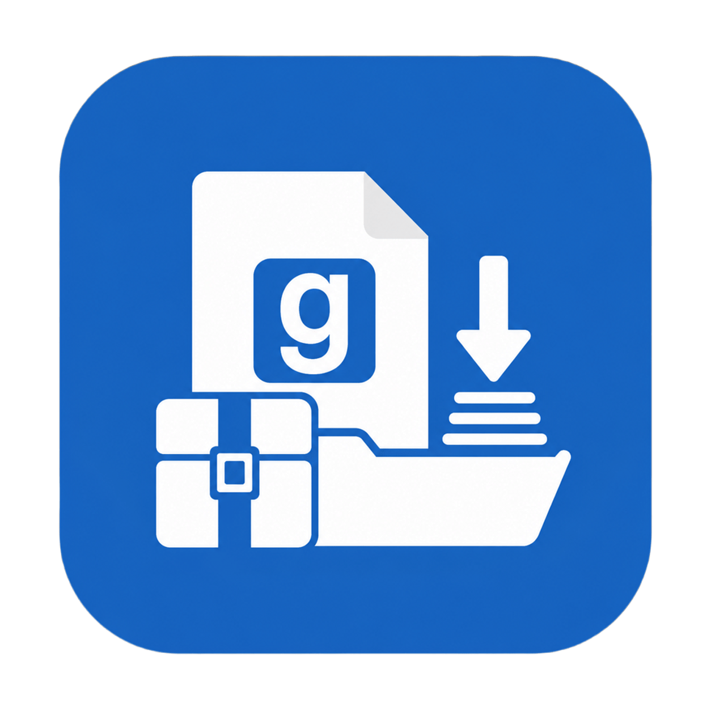
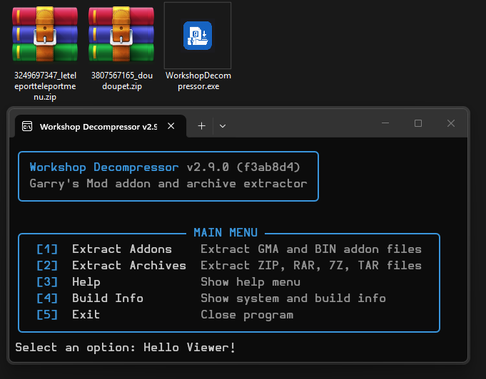
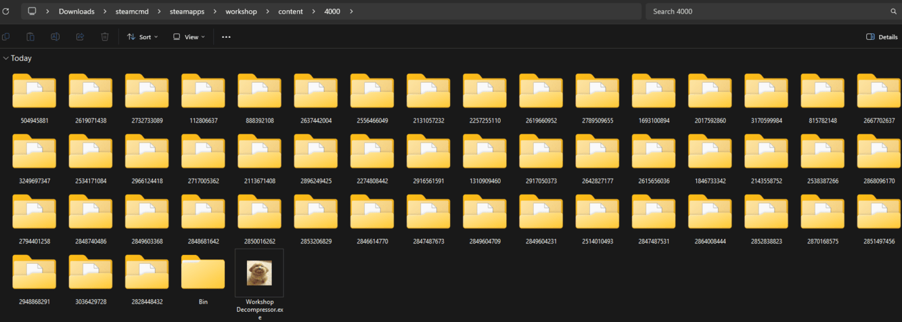

# Workshop Decompressor

**A fast, cross-platform CLI tool that unpacks Garry's Mod addons and archives. No installs, no dependencies, just drop it in.**

  
  
  
  

  
  
  
  
  
  
  
  
  
  
  

> 💡 **Enjoy the project?**
> If you have a GitHub account and found this repository helpful, please consider giving it a ⭐! It helps others discover the tool and it makes me happy!

# Overview

Workshop Decompressor is a free, open-source command-line tool for Garry's Mod players who need to unpack addon files. It handles both modern `.gma` addons and legacy `.bin` addons through the bundled fastgmad and 7-Zip binaries, and it doubles as a general archive extractor. Drop it into your addon folder, pick an option, done.

## Table of Contents

- [Features](#features)
- [Coming from GWTool?](#coming-from-gwtool)
- [System Requirements](#system-requirements)
- [Good to Know](#good-to-know)
- [How to Use It](#how-to-use-it)
- [Building from Source](#building-from-source)
- [How to Contribute](#how-to-contribute)
- [License](#license)
- [Credits](#credits)

## Features

- **Dual Addon Support** - Extracts both modern `.gma` addons and legacy `.bin` addons from SteamCMD, websites, or offline installs.
- **Universal Archive Extraction** - Unpacks `.zip`, `.rar`, `.7z`, `.tar`, `.tar.gz`, `.tar.xz` and `.tar.bz2` with the included 7-Zip, so there is nothing to install.
- **Smart Multithreading** - Extraction scales to your CPU with built-in headroom, so your PC stays responsive.
- **Clean Console UI** - Numbered steps, live progress with file counts, per-file warnings, and a completion summary, powered by Rich.
- **Cross-Platform** - One native executable per OS, with the extraction tools already inside: no setup, just run it.
- **Drop-in GWTool Replacement** - Point it at your addons and it does the rest, no manual steps.

## Coming from GWTool?

Both tools can extract Garry's Mod addons, but they take different approaches. GWTool is a Windows-only GUI that's been around for years, while Workshop Decompressor is a modern, cross-platform tool that aims to make extracting addons as simple as possible.

| **What people actually care about** | **GWTool**              | **Workshop Decompressor** |
| -----------------------------------|--------------------------|---------------------------|
| Works on Windows                   | ✅                       | ✅                        |
| Works on macOS & Linux             | ❌                       | ✅                        |
| Open modern `.gma` files           | ✅                       | ✅                        |
| Open legacy `.bin` files           | ⚠️ Multiple manual steps | ✅ Just drop it in        |
| Handles ZIP, RAR, 7Z, TAR...       | ❌                       | ✅                        |
| Still getting updates              | ❌ Last updated in 2012  | ✅ Ongoing development    |

## System Requirements

#### Operating Systems

| Operating System | Supported Versions                                       | Architecture | Tested   |
|------------------|----------------------------------------------------------|--------------|----------|
| Windows          | 11, 10 (1809 or later)                                   | 64-Bit       |   ✅     |
| GNU/Linux        | Debian 13, Ubuntu 22.04, Fedora 44, Arch Linux, OpenSUSE | 64-Bit       |   ✅     |
| macOS            | 14.4 (Ventura) and higher                                | ARM64        |   ❌     |

> **macOS:** Built for Apple Silicon. I don't own a Mac to verify, but it should work.

### Resource Footprint

- **RAM Usage:** ~40MB
- **Disk Space:** ~50MB

## Good to Know

- The very first launch of a newly downloaded or built version can sit on a blank window for several seconds (up to 15s with strict antivirus): the single executable unpacks itself while your antivirus inspects it. Every start after that takes about a second.
- Legacy addons (`.bin`) sometimes make 7-Zip print a scary "data after the end of the payload data" message. That is normal: the files still extract fine, and the tool reports it as a warning instead of a failure.
- The folder you run it from needs to be writable. The tool checks this up front and tells you if it isn't.
- On Linux and macOS, run `chmod +x WorkshopDecompressor` once so the program is allowed to start. The bundled tools fix their own permissions automatically.
- Colors follow the `NO_COLOR` standard: set that environment variable to any non-empty value and the interface drops ANSI colors while keeping bold and underline styling.

## How to Use It

1. Download the program for your OS from the [latest release page](https://github.com/Mitra-88/WorkshopDecompressor/releases/latest).
2. Put it in the folder with your addons. If you use SteamCMD, that is usually `steamapps/workshop/content/4000`.

3. Run it and pick an option: `[1]` extracts addons, `[2]` extracts archives, `[3]` shows help.

**When it's finished:** everything you unpacked is in the `Extracted-Addons` folder (or a folder right next to each archive). Your original files are safely kept in `Leftover`, think of it as a backup copy. Once you're happy everything worked, delete `Leftover` to clean up.

## Building from Source

Please refer to the [build instructions](BUILD.md) for details on building Workshop Decompressor from source. Fresh setup is two commands: install [uv](https://docs.astral.sh/uv/), then `uv sync`.

## How to Contribute

1. **Found a bug?** → [Open an issue](https://github.com/Mitra-88/WorkshopDecompressor/issues) with steps to reproduce and the version string from the Build Info menu option
2. **Have an idea?** → [Open a feature request](https://github.com/Mitra-88/WorkshopDecompressor/issues)
3. **Want to contribute code?** → Fork the repo, make your changes, and [submit a pull request](https://github.com/Mitra-88/WorkshopDecompressor/pulls)

Please check existing issues and PRs before opening a new one to avoid duplicates.

## License

This project is licensed under the [GNU General Public License v3.0](LICENSE).

## Credits

### Tools & Technologies

- [7-Zip](https://www.7-zip.org/): For extracting `.bin`, `.rar`, and every other supported archive format (bundled, forked).
- [FastGMAD](https://github.com/WilliamVenner/fastgmad): Fast reimplementation of gmad, used for `.gma` extraction (bundled, forked).
- [Rich](https://rich.readthedocs.io/en/latest/): For beautiful console formatting, progress bars, and enhanced terminal output.
- [PyInstaller](https://www.pyinstaller.org/): For creating standalone executables.
- [Ruff](https://docs.astral.sh/ruff/): Python linter and code formatter.
- [uv](https://docs.astral.sh/uv/): Python project and environment management.

## Disclaimer

To be absolutely clear: this project is not affiliated with or endorsed by Facepunch Studios or Valve. Garry's Mod and Steam Workshop are the property of their respective owners. The bundled 7-Zip and fastgmad binaries are distributed under their own licenses, included next to them in the `Src/Bin` folder and in every download.

_Made with ❤️ by Mitra-88_
